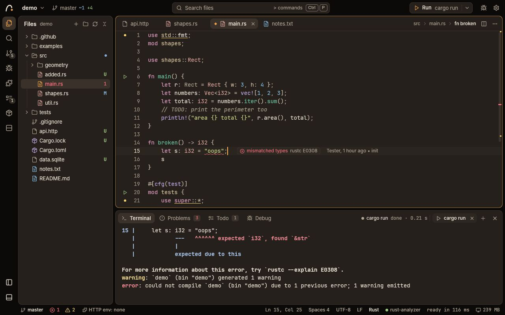
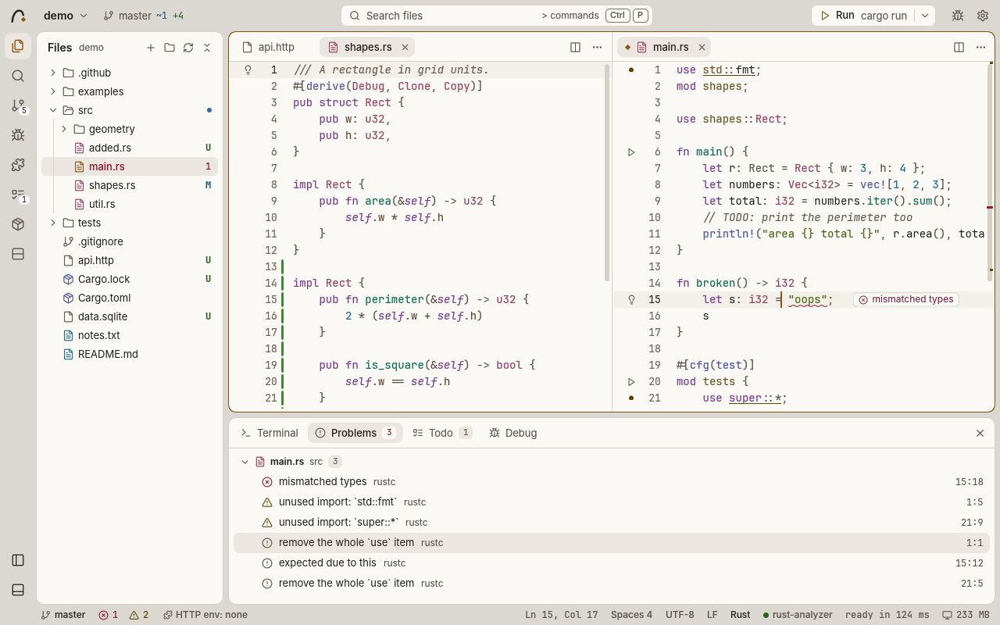
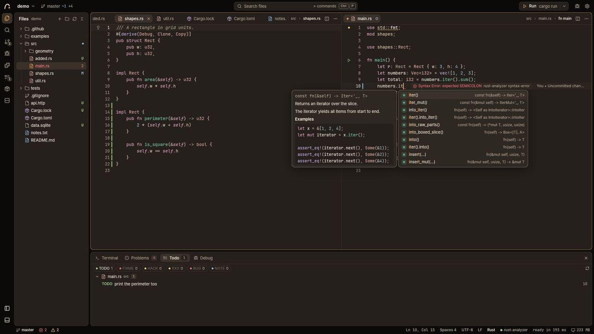
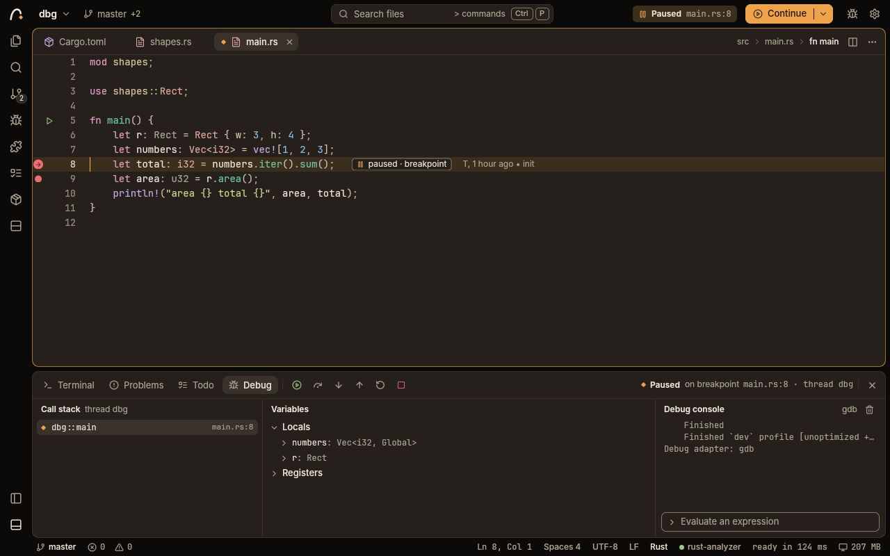
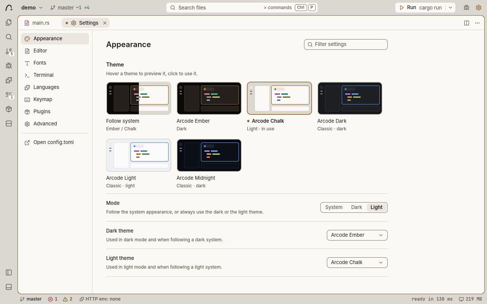
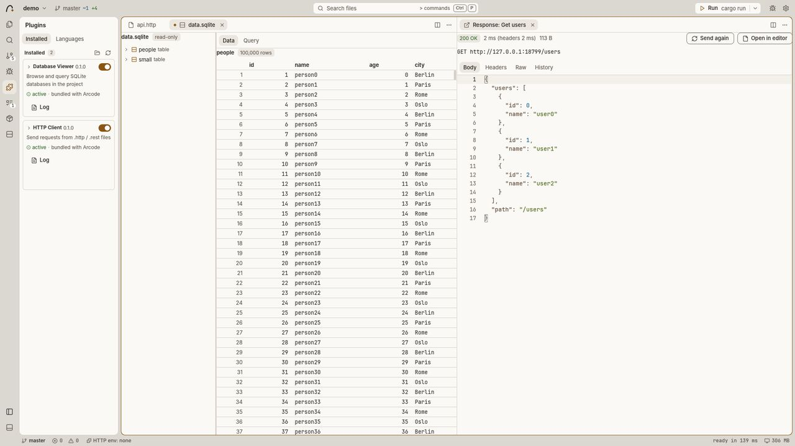

# Arcode

[](https://github.com/musasacc/arcode/actions/workflows/ci.yml)

Arcode is a native, open-source IDE written in Rust on top of
[GPUI](https://crates.io/crates/gpui). It starts fast, stays small, and
runs well on laptops with integrated graphics.

- **Native.** One Rust binary drawn on the GPU. No Electron, no web view.
- **Light.** An idle window draws nothing; it redraws only when something
  changes. Low-end mode turns off animations, shadows and other extras for
  older machines.
- **Offline by default.** Arcode makes no network connections on its own.
  Anything that does go online (a plugin request, a package update check)
  only happens when you click for it.
- **No telemetry, no account.** There is nothing to sign in to and nothing
  is reported anywhere.

Arcode is in early development (version 0.0.1). There are no prebuilt
releases yet, so for now you build it from source. It runs on Linux, macOS
and Windows. Linux gets the most testing.

## Screenshots



| | |
|---|---|
|  |  |
|  |  |



## Features

### Editor

- Fast text editing on a rope buffer, with tree-sitter syntax highlighting
  and incremental reparsing.
- Multiple cursors: add the next occurrence, select all occurrences, add
  cursors above or below, Alt+click, box selection with Alt+Shift+drag.
- Built-in Vim mode (Normal, Insert, Visual and Replace modes, operators,
  text objects, registers, macros, dot repeat, `/` search and `:w`, `:q`,
  `:s`, `:e`). Toggle it any time from the command palette.
- Snippets (built in, plus your own in `snippets.toml`) with tab stops,
  placeholders, mirrors and choices.
- Split panes, tabs, soft wrap, bracket matching, indentation detection,
  line ending and encoding display.
- Large files stay responsive: above 4 MiB or 50,000 lines only the visible
  part is parsed for highlighting.
- Sessions: open tabs, splits, cursors, scroll positions and panels come
  back when you reopen a project, and the projects you had open come back
  when you restart.

### Language intelligence

- Language Server Protocol client with completion, signature help, hover,
  go to definition / type definition / implementation, find references,
  document and workspace symbols, rename, code actions with a light bulb,
  formatting (also on save), inlay hints and occurrence highlighting.
- Several language servers per file. For example rust-analyzer plus a spell
  checker: diagnostics, completion and code actions are merged, other
  requests go to the servers in the order you set.
- Diagnostics as squiggles, inline messages and a Problems panel.
- Without a language server you still get words from open files, file path
  completion and a tree-sitter outline for symbol navigation.
- Saving `config.toml` applies server changes immediately and restarts only
  the servers whose settings changed.

### Run and debug

- Run buttons in the gutter for `main` functions and tests in Rust, Python,
  JavaScript / TypeScript and Go.
- A Run button in the title bar with the project's detected command
  (`cargo run`, an npm `start` script, `go run .`, ...), or any command you
  type.
- Debugging through the Debug Adapter Protocol with CodeLLDB, lldb-dap,
  GDB 14+, debugpy and Delve: breakpoints (with conditions, hit counts and
  log messages), call stack, variables, watch expressions and a debug
  console with a REPL.
- Your own launch configurations in `.arcode/launch.toml`.

See [docs/DEBUGGING.md](docs/DEBUGGING.md) for details.

### Git

- Change bars in the gutter, with a popover to stage, unstage or revert a
  single hunk.
- Inline blame for the cursor line and a blame column.
- Source Control view: stage, unstage, commit, switch or create branches,
  open diffs.
- Merge conflicts with Accept Current / Incoming / Both actions above each
  conflict.
- Arcode works with your local repository only. It never fetches, pulls or
  pushes; use the terminal for that.

### Search and navigation

- Fuzzy file finder and a command palette that shows only the commands
  that apply where you are.
- Find and replace in the current file, with regular expressions.
- Project-wide search and replace that respects `.gitignore` and streams
  results as they are found.
- Go to symbol in the file or the workspace, back and forward through your
  jump history.
- A TODO view that collects `TODO`, `FIXME`, `HACK` and other tags from the
  whole project and stays up to date as files change.

### Terminal

- Integrated terminal (based on `alacritty_terminal`) with several tabs in
  the bottom panel.
- Run commands, tests and package manager commands open in named tabs that
  are reused when idle.
- Arcode asks before closing a window or project while a terminal is still
  running a command.

### Plugins

- Plugins are sandboxed WebAssembly components (`wasm32-wasip2`) run with
  wasmtime. A plugin can only read your project, use the network or edit
  documents after you allow it, and the host enforces that.
- An idle plugin costs nothing: no engine is started until a plugin is
  actually used.
- Two plugins come with Arcode:
  - **HTTP Client**: send requests from `.http` / `.rest` files and see
    the response next to the editor.
  - **Database Viewer**: browse and query SQLite databases in your project.
- Install a plugin from a local folder, or load one unpacked while you
  develop it. There is no plugin store and no automatic update.

### Packages view

- Lists the dependencies of every manifest in the project, read offline
  from the manifest and its lockfile: Cargo, npm, pnpm, Yarn, Bun, uv,
  Poetry, Pipenv, pip requirements, Go modules, Composer and Bundler.
- Add, remove and update packages with each manager's own command, run in
  a terminal tab.
- "Check for updates" asks the package managers for newer versions, only
  when you click it.
- A banner offers to install packages when a project's dependencies are
  missing (for example `package.json` without `node_modules`). Nothing is
  installed unless you click.

### Themes and settings

- Two built-in themes, **Arcode Ember** (dark) and **Arcode Chalk**
  (light), plus the classic Arcode Dark, Arcode Light and Arcode Midnight.
  Follow the system appearance or pick one.
- A Settings page with live previews of themes and fonts. Every change is
  written to `config.toml`, keeping your comments.
- Your own themes as TOML files in the `themes` folder next to
  `config.toml`.
- Bundled fonts: JetBrains Mono for code and Inter for the interface.
- A short first-run setup (theme, font, keymap, performance) and an
  optional guided tour.

### Low-end mode

Turn it on in the first-run dialog, in Settings, or with "Preferences:
Toggle Low-End Mode". It turns off animations and cursor blinking, draws
popups without shadows, turns off inlay hints and inline blame, and waits
longer before refreshing git and diagnostics. Turning it off again
restores only what low-end mode changed.

## Installing

There are no binary packages yet. Build Arcode from source as described
below; it takes a few minutes the first time.

### Prerequisites

All platforms:

- [rustup](https://rustup.rs). The repository pins its Rust toolchain in
  `rust-toolchain.toml` (currently Rust 1.97.0 with the `wasm32-wasip2`
  target), and rustup installs it on the first `cargo` command.
- `git`, which Arcode uses for its git features, and `curl` for the
  rustup script. The Linux commands below install both.

**Linux:** a C compiler, pkg-config and the development packages of a
few system libraries. Install them first:

```sh
# Debian / Ubuntu
sudo apt-get update
sudo apt-get install build-essential pkg-config git curl \
  libxkbcommon-dev libxkbcommon-x11-dev libwayland-dev libvulkan-dev \
  libx11-xcb-dev libxcb1-dev libfontconfig-dev libfreetype-dev \
  libssl-dev libzstd-dev

# Fedora
sudo dnf install gcc pkgconf-pkg-config git curl libxkbcommon-devel \
  libxkbcommon-x11-devel wayland-devel vulkan-loader-devel libX11-devel \
  libxcb-devel fontconfig-devel freetype-devel openssl-devel libzstd-devel

# Arch Linux
sudo pacman -Syu --needed base-devel git curl libxkbcommon libxkbcommon-x11 \
  wayland vulkan-icd-loader libx11 libxcb fontconfig freetype2 openssl zstd

# openSUSE Tumbleweed
sudo zypper install gcc pkgconf-pkg-config git curl libxkbcommon-devel \
  libxkbcommon-x11-devel wayland-devel vulkan-devel libX11-devel \
  libxcb-devel fontconfig-devel freetype2-devel libopenssl-devel libzstd-devel

# Void Linux (glibc)
sudo xbps-install -S base-devel git curl libxkbcommon-devel wayland-devel \
  vulkan-loader-devel libX11-devel libxcb-devel fontconfig-devel \
  freetype-devel openssl-devel libzstd-devel

# Alpine Linux (also needs one Cargo setting, see the installation guide)
sudo apk add build-base pkgconf git curl libxkbcommon-dev wayland-dev \
  vulkan-loader-dev libx11-dev libxcb-dev fontconfig-dev freetype-dev \
  openssl-dev zstd-dev

# NixOS: no packages to install; build and run Arcode inside the
# repository's shell.nix, which also brings rustup and git
nix-shell
```

Then install rustup (not needed on NixOS) and load it into the current
shell, or open a new terminal:

```sh
curl --proto '=https' --tlsv1.2 -sSf https://sh.rustup.rs | sh
. "$HOME/.cargo/env"
```

On other distributions, look for the packages of xkbcommon (with its X11
part), Wayland, the Vulkan loader, xcb (with X11-xcb), fontconfig,
FreeType, OpenSSL and zstd, plus pkg-config and a C compiler.

Arcode draws with Vulkan, so you also need a Vulkan driver. Mesa's
drivers cover Intel and AMD GPUs and NVIDIA's open driver, and its
software driver (lavapipe) works on machines without a usable GPU;
NVIDIA's own driver ships its own Vulkan driver.

| Distribution | Mesa Vulkan driver | Software driver | Vulkan loader |
|---|---|---|---|
| Debian / Ubuntu | `mesa-vulkan-drivers` | included | pulled in by the driver |
| Fedora | `mesa-vulkan-drivers` | included | pulled in by the driver |
| Arch Linux | `vulkan-intel`, `vulkan-radeon` or `vulkan-nouveau` | `vulkan-swrast` | `vulkan-icd-loader` |
| openSUSE Tumbleweed | `libvulkan_intel`, `libvulkan_radeon` or `libvulkan_nouveau` | `libvulkan_lvp` | `libvulkan1` |
| Void Linux | `mesa-vulkan-intel`, `-radeon` or `-nouveau` | `mesa-vulkan-lavapipe` | `vulkan-loader` |
| Alpine Linux | `mesa-vulkan-intel`, `-ati` or `-nouveau` | `mesa-vulkan-swrast` | `vulkan-loader` |
| NixOS | `hardware.graphics.enable = true;` | included | in `shell.nix` |

The build packages above already bring the Vulkan loader. If you run
Arcode on a machine where you did not build it, install the loader named
in the last column together with the driver.

Both X11 and Wayland are supported. The
[installation guide](docs/guide/installation.md#linux) has the details
for each distribution and the versions they were tested on.

**macOS:** install Xcode from the App Store, not only the Command Line
Tools. GPUI compiles its Metal shaders with `xcrun metal` during the
build. Open Xcode once to accept the license.

**Windows:** install Visual Studio 2022 or the Build Tools for Visual
Studio with the "Desktop development with C++" workload (MSVC and the
Windows SDK; GPUI compiles its shaders with the SDK's `fxc.exe`). Git for
Windows also gives you the bash shell the helper scripts in `scripts/` need.

### Build and run

```sh
git clone https://github.com/musasacc/arcode.git
cd arcode
cargo run -p arcode
```

Open a folder or file directly:

```sh
cargo run -p arcode -- path/to/project
cargo run -p arcode -- path/to/file.rs    # opens its project and the file
```

Debug builds are already fast to use, because all dependencies are built
with optimizations. For a release build:

```sh
cargo build --release -p arcode
./target/release/arcode path/to/project
```

### The bundled plugins (optional)

Arcode runs fine without its plugins. To build the HTTP Client and the
Database Viewer you need the `wasm32-wasip2` target (rustup adds it from
`rust-toolchain.toml`). The Database Viewer compiles SQLite from C, so it
also needs clang, `llvm-ar` and the wasi-libc headers; the HTTP Client is
pure Rust and builds without them. Install them from your distribution
(the script finds them on its own) or use the WASI SDK:

- Debian / Ubuntu: `sudo apt-get install clang llvm wasi-libc`
- Fedora: `sudo dnf install clang llvm wasi-libc-devel`
- Arch Linux: `sudo pacman -Syu --needed clang llvm wasi-libc`
- openSUSE Tumbleweed: `sudo zypper install clang llvm wasi-libc`
- Void Linux: `sudo xbps-install -S clang llvm wasi-libc`
- Alpine Linux: `sudo apk add clang llvm wasi-libc bash`
- NixOS: `nix-shell --arg withPlugins true` sets everything up.
- macOS, Windows or anywhere else: unpack the
  [WASI SDK](https://github.com/WebAssembly/wasi-sdk/releases) (CI uses
  version 25) and point the script at it:

  ```sh
  export WASI_INCLUDE="$HOME/wasi-sdk/share/wasi-sysroot/include/wasm32-wasip2"
  export CC_wasm32_wasip2="$HOME/wasi-sdk/bin/clang"     # clang.exe on Windows
  export AR_wasm32_wasip2="$HOME/wasi-sdk/bin/llvm-ar"   # llvm-ar.exe on Windows
  ```

  The header of `scripts/build-plugins.sh` lists every variable it reads.

Then:

```sh
scripts/build-plugins.sh               # both bundled plugins
scripts/build-plugins.sh http-client   # just one (no C toolchain needed)
```

This writes the plugins to `target/wasm-plugins/`, where an Arcode binary
built in this checkout (debug or release) finds them. The example plugin in
`plugins/hello-world` is not bundled and is built only when you name it:
`scripts/build-plugins.sh hello-world`.

### Packaging

`scripts/package.sh` builds a release binary and the plugins and lays them
out as a folder you can install or move anywhere (`bin/arcode` plus
`share/arcode/plugins/`). `ARCHIVE=1 scripts/package.sh` also writes a
`.tar.gz` (a `.zip` on Windows). See [docs/PACKAGING.md](docs/PACKAGING.md)
for the layout on each platform.

## First run

The first time Arcode starts it shows a short setup dialog: pick a theme,
an editor font, the keymap (default or Vim) and the performance mode.
"Save and Continue" writes your choices to `config.toml` and offers a
quick tour of the window; "Skip" writes the defaults. You can open the
dialog again with "Help: Show Welcome Setup" and the tour with "Help:
Start Tour".

Then open a folder with Ctrl+O (Cmd+O on macOS), or start Arcode with a
path as shown above. Press Ctrl+Shift+P (Cmd+Shift+P) or F1 at any time
to search every command.

## Configuration

All settings live in one file, `config.toml`. The Settings page
(Ctrl+, / Cmd+,) edits it for you, and "Preferences: Open Settings File
(config.toml)" opens it in the editor. Saving the file applies it at once.

| OS | `config.toml` |
|---|---|
| Linux | `~/.config/arcode/config.toml` (or `$XDG_CONFIG_HOME/arcode/`) |
| macOS | `~/Library/Application Support/arcode/config.toml` |
| Windows | `%APPDATA%\arcode\config.toml` |

Set `ARCODE_CONFIG_DIR` to use another folder, for example for a portable
setup. The same folder holds `snippets.toml` and a `themes/` folder for
your own themes. Window and session state is kept separately in
`state.toml` in the data folder (`~/.local/share/arcode/` on Linux,
overridden by `ARCODE_DATA_DIR`).

A new `config.toml` lists every option with its default and a comment, so
the file itself is the reference. A short example:

```toml
[editor]
font_family = "JetBrains Mono"
font_size = 14.0
tab_size = 4
format_on_save = true
vim_mode = false

[ui]
theme = "system"               # "system", "dark", "light" or a theme name
dark_theme = "Arcode Ember"
light_theme = "Arcode Chalk"
low_end_mode = false

[files]
associations = { "*.mdx" = "markdown" }

# Add a second language server for Python and turn off a feature of it.
[language.python]
servers = ["pyright-langserver", "ruff"]

[lsp.ruff]
command = "ruff"
args = ["server"]
features = { hover = false }
```

The full default file is
[crates/arcode-config/assets/default-config.toml](crates/arcode-config/assets/default-config.toml),
and the [user guide](docs/guide/) explains each section.

## Keyboard shortcuts

These are the defaults. On macOS, Cmd takes the place of Ctrl in most
shortcuts; the table shows where it differs. The command palette shows the
shortcut of every command.

| Action | Linux / Windows | macOS |
|---|---|---|
| Command palette | Ctrl+Shift+P, F1 | Cmd+Shift+P, F1 |
| Find file | Ctrl+P | Cmd+P |
| Open folder | Ctrl+O | Cmd+O |
| Settings | Ctrl+, | Cmd+, |
| Select theme | Ctrl+K Ctrl+T | Cmd+K Cmd+T |
| Change the file's language | Ctrl+K M | Cmd+K M |
| Toggle sidebar / bottom panel | Ctrl+B / Ctrl+J | Cmd+B / Cmd+J |
| Split right | Ctrl+\ | Cmd+\ |
| Close tab | Ctrl+W | Cmd+W |
| Save | Ctrl+S | Cmd+S |
| Find / replace in file | Ctrl+F / Ctrl+H | Cmd+F / Cmd+Option+F |
| Find / replace in files | Ctrl+Shift+F / Ctrl+Shift+H | Cmd+Shift+F / Cmd+Shift+H |
| Trigger completion | Ctrl+Space | Ctrl+Space |
| Parameter hints | Ctrl+Shift+Space | Ctrl+Shift+Space |
| Show hover | Ctrl+K Ctrl+I | Cmd+K Cmd+I |
| Go to definition | F12 | F12 |
| Go to implementation | Ctrl+F12 | Cmd+F12 |
| Find all references | Shift+F12 | Shift+F12 |
| Go to symbol in file / workspace | Ctrl+Shift+O / Ctrl+T | Cmd+Shift+O / Cmd+T |
| Go back / forward | Alt+Left / Alt+Right | Ctrl+- / Ctrl+Shift+- |
| Code actions | Ctrl+. | Cmd+. |
| Rename symbol | F2 | F2 |
| Format document | Shift+Alt+F | Shift+Option+F |
| Format selection | Ctrl+K Ctrl+F | Cmd+K Cmd+F |
| Toggle line comment | Ctrl+/ | Cmd+/ |
| Select next occurrence / all occurrences | Ctrl+D / Ctrl+Shift+L | Cmd+D / Cmd+Shift+L |
| Add cursor above / below | Ctrl+Alt+Up / Down | Cmd+Option+Up / Down |
| Move line up / down | Alt+Up / Down | Option+Up / Down |
| New terminal | Ctrl+Shift+\` | Cmd+Shift+\` |
| Focus terminal | Ctrl+\` | Ctrl+\` |
| Source control | Ctrl+Shift+G | Cmd+Shift+G |
| Toggle blame column | Ctrl+Alt+B | Cmd+Option+B |
| Run project | Ctrl+F5 | Cmd+F5 |
| Run and Debug view | Ctrl+Shift+D | Cmd+Shift+D |
| Start debugging / continue | F5 | F5 |
| Stop / restart debugging | Shift+F5 / Ctrl+Shift+F5 | Shift+F5 / Cmd+Shift+F5 |
| Step over / into / out | F10 / F11 / Shift+F11 | F10 / F11 / Shift+F11 |
| Toggle breakpoint | F9 | F9 |
| Quit | Ctrl+Q | Cmd+Q |

## Languages

Every language below has tree-sitter syntax highlighting built in and a
default language server configured:

| Language | Default language server |
|---|---|
| Rust | `rust-analyzer` |
| Python | `pyright-langserver` (from pyright) |
| JavaScript, TypeScript, JSX, TSX | `typescript-language-server` |
| Go | `gopls` |
| C, C++ | `clangd` |
| Java | `jdtls` |
| Ruby | `ruby-lsp` |
| PHP | `intelephense` |
| Lua | `lua-language-server` |
| Bash / shell | `bash-language-server` |
| HTML, CSS, JSON | `vscode-html-language-server`, `vscode-css-language-server`, `vscode-json-language-server` |
| YAML | `yaml-language-server` |
| TOML | `taplo` |
| Markdown | `marksman` |

**How language servers are found.** Arcode never downloads or installs a
language server. It starts the command configured for the language and
looks it up on your `PATH` (on Windows also with the `.cmd` / `.bat`
extensions that npm uses). If a server is missing, the status bar shows
"not installed" and a one-time message names the command. The Languages
page (Plugins view, or "Languages: Show Language Packs") lists every
language with its servers, shows which are installed, and gives the
install command for your OS to copy.

To use a server that is not on `PATH`, or a different one, set it in
`config.toml`:

```toml
[lsp.rust-analyzer]
command = "/opt/rust-analyzer/bin/rust-analyzer"
```

Other file types open as plain text, and `[files] associations` maps file
patterns to any of the languages above.

## Privacy

Arcode itself does not connect to the internet. There is no telemetry, no
crash reporting, no update check, no account and no plugin store. It
never downloads language servers, debuggers or packages for you.

Network access only happens as a direct result of something you do:

- **Plugins.** A plugin may only use the network while handling your click
  (for example "Send request" in the HTTP Client), and Arcode asks you
  before it contacts each new host. Background network access is never
  granted by default. `[plugins] network = false` turns off plugin
  networking completely. Each plugin's Permissions section in the Plugins
  view lists its grants with a Revoke button, and a network log lists
  each request (method, host, status; no bodies).
- **Packages.** "Check for updates", "Install packages" and Add / Update
  in the Packages view run your package manager (cargo, npm, uv, ...),
  which talks to its registry.
- **Programs you run.** Commands in the terminal, run buttons and the
  debugger run your own tools. Language servers and debug adapters are
  separate programs you installed; some of them (for example those that
  invoke your build tool) may go online on their own.

Git operations stay local; Arcode never fetches, pulls or pushes.

Settings, session state and plugin permissions are stored only in your
user config and data folders, never in the project. A file inside a
repository cannot install, enable or grant permissions to a plugin.

## Writing plugins

Plugins are written in Rust against the `arcode-plugin-api` crate and
built for `wasm32-wasip2`. A plugin is a folder with a `plugin.toml` and a
`plugin.wasm`; it describes its UI as a tree of widgets that Arcode draws
natively. To try one, run "Plugins: Load Unpacked…" on its folder.

Start with the [plugin author guide](docs/plugins/README.md):

- [Getting started](docs/plugins/getting-started.md): build and load your
  first plugin
- [The manifest](docs/plugins/manifest.md): `plugin.toml` reference
- [API reference](docs/plugins/api.md): commands, documents, files,
  network, storage
- [Building UI](docs/plugins/ui.md): panels, views and widgets
- [Permissions](docs/plugins/permissions.md): what a plugin can ask for
  and how users grant it
- [Testing](docs/plugins/testing.md): unit tests without wasm, end-to-end
  tests in the host
- [Publishing](docs/plugins/publishing.md): packaging and sharing a plugin

The quickest start is the small, commented example plugin in
[plugins/hello-world](plugins/hello-world): a palette command, a code lens
and a sidebar panel. Copy it and change it. The two bundled plugins in
[plugins/](plugins/) are complete, larger examples, and
[docs/PLUGINS.md](docs/PLUGINS.md) is the full design of the plugin system.

## Documentation

- [User guide](docs/guide/): using Arcode day to day
- [Plugin author guide](docs/plugins/README.md): writing plugins
  (see the list above)
- [docs/ARCHITECTURE.md](docs/ARCHITECTURE.md): how the crates fit
  together, threading, and how each feature is built
- [docs/DEBUGGING.md](docs/DEBUGGING.md): run buttons, debug adapters,
  `launch.toml`, breakpoints
- [docs/PLUGINS.md](docs/PLUGINS.md): plugin system design, WIT interface,
  permission model
- [docs/DESIGN.md](docs/DESIGN.md): visual design, colour tokens, theme
  files
- [docs/UI_SPEC.md](docs/UI_SPEC.md): window layout and keyboard model
- [docs/PACKAGING.md](docs/PACKAGING.md): release layout and how the app
  finds its plugins
- [docs/SPIKE.md](docs/SPIKE.md): rendering and plugin engine measurements

## Project layout

| Path | What it is |
|---|---|
| `crates/arcode` | The application: window, panes, sidebar views, panels, wiring of all features |
| `crates/arcode-buffer` | Rope text buffer: edits, selections, undo/redo, coordinate conversion |
| `crates/arcode-syntax` | Language registry, tree-sitter parsing, highlighting, outline and run queries |
| `crates/arcode-editor` | The GPUI code editor view and its extension points |
| `crates/arcode-completion` | Completion ranking, buffer words, path completion, snippets |
| `crates/arcode-lsp` | Language server client: JSON-RPC over stdio, several servers per file |
| `crates/arcode-dap` | Debug Adapter Protocol client and known adapters |
| `crates/arcode-git` | Local git integration through the `git` CLI (no network) |
| `crates/arcode-search` | Project search and TODO scanning |
| `crates/arcode-project` | Project detection: run commands, language packs, package manifests |
| `crates/arcode-terminal` | Terminal emulation and PTY handling |
| `crates/arcode-terminal-view` | The GPUI view for the terminal |
| `crates/arcode-config` | `config.toml`, themes, fonts and saved state |
| `crates/arcode-ui-kit` | Shared UI layer: theme, metrics, icons, components |
| `crates/arcode-vim` | Vim mode state machine |
| `crates/arcode-plugin-api` | Plugin SDK and WIT interface for plugin authors |
| `crates/arcode-plugin-host` | Sandboxed WebAssembly plugin host (wasmtime) |
| `crates/arcode-spike` | Standalone benchmark: scrolls a 100k-line file and reports frame times |
| `plugins/` | The bundled HTTP Client and Database Viewer plugins, plus the `hello-world` example (separate cargo workspace) |
| `scripts/` | Plugin builds, packaging and CI helpers |
| `assets/` | Bundled fonts and icons |
| `docs/` | Documentation |

Only `arcode`, `arcode-editor`, `arcode-terminal-view`, `arcode-ui-kit`
and `arcode-spike` depend on GPUI; the other crates build and test without
it.

## Contributing

Contributions are welcome. Please read [CONTRIBUTING.md](CONTRIBUTING.md)
before opening a pull request. The checks CI runs:

```sh
cargo build --workspace --locked
scripts/build-test-plugins.sh && scripts/build-plugins.sh   # needed by the plugin host tests
cargo test --workspace --locked
cargo clippy --workspace --all-targets --locked -- -D warnings
cargo fmt --all -- --check
```

The plugins (bundled and example) have their own native unit tests:
`cargo test --manifest-path plugins/Cargo.toml`.

## License

Arcode is dual-licensed under either of

- Apache License, Version 2.0 ([LICENSE-APACHE](LICENSE-APACHE))
- MIT license ([LICENSE-MIT](LICENSE-MIT))

at your option.

Unless you explicitly state otherwise, any contribution you intentionally
submit for inclusion in Arcode, as defined in the Apache-2.0 license,
is dual-licensed as above, without any additional terms or conditions.

The bundled fonts are under the SIL Open Font License: JetBrains Mono
([assets/fonts/jetbrains-mono/OFL.txt](assets/fonts/jetbrains-mono/OFL.txt))
and Inter ([assets/fonts/inter/OFL.txt](assets/fonts/inter/OFL.txt)). The
icons are from Lucide, under the ISC license
([assets/icons/LICENSE](assets/icons/LICENSE)).
